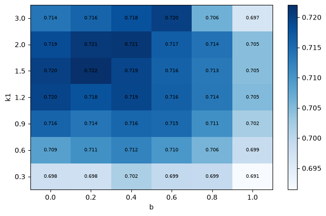
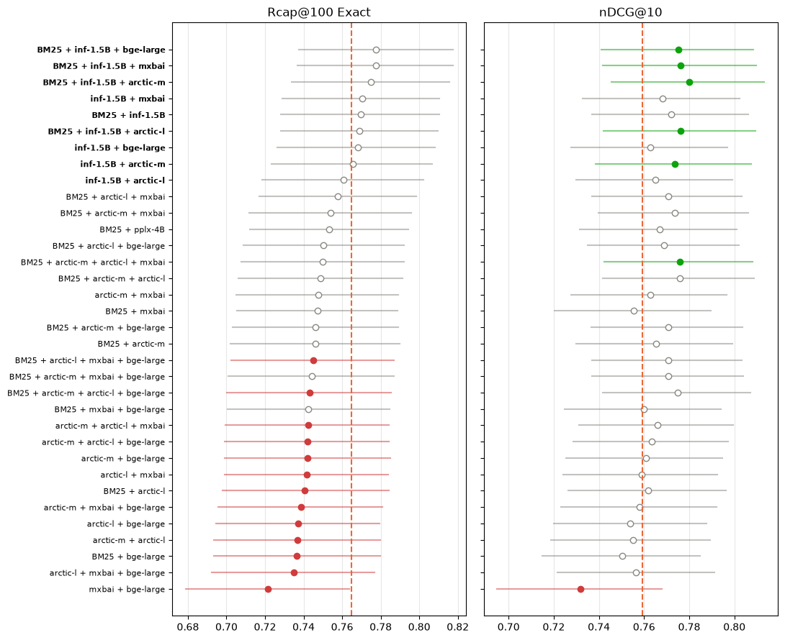

# Product search on a small catalogue

[](LICENSE)
[](https://www.python.org/)
[](https://github.com/astral-sh/uv)
[](https://github.com/astral-sh/ruff)
[](https://mypy-lang.org/)
[](https://github.com/wayfair/WANDS)
[](https://github.com/OlleOltorp/llm-product-search)
[](https://github.com/OlleOltorp/llm-product-search/commits/main)

This was an exploratory study in preparation for a possible master's thesis in search. I tested the leading open-source models from different benchmarks, hybrid setups, and pipelines with rerankers and with query and product expansion. All models were used out of the box, but every setup was tested thoroughly on the key ranking metrics and on latency for production use.

## Results


*Best setting at each stage, chosen on dev (hollow) and checked once on test (filled). Figure 2 in [notebook 08](notebooks/08_test.ipynb).*

| Stage | nDCG@10 (test) | Change | p99 latency | Kept |
|---|---|---|---|---|
| BM25 | 0.710 | – | 1.3 ms | baseline |
| + dense (inf-retriever-v1-1.5b) | 0.786 | +7.6 vs BM25 | 28 ms | ✓ |
| + hybrid (BM25 + 2 dense models, RRF) | **0.804** | **+1.9 vs dense** | **37 ms** | ✓ |
| + reranker (zerank-2) | dev only | +0.9 on dev | ~470 ms | ✗ too slow |
| + LLM expansion | 0.808 | +0.3, not significant | 467 ms | ✗ |

- Hybrid search gave the reliable gain: +1.9 nDCG@10 on test, 37 ms.
- Rerankers and LLM expansion each cost ~10× the latency for at most one point, and the expansion gain did not hold on test.
- LLM expansion helps plain BM25 a lot: 151 of 161 combinations still significantly better on test.

*nDCG@10: quality of the top 10 results (0–1). Rcap@100: share of the right products found in the top 100. Change: test-set difference in points against the stage above (paired permutation test).*

## How it was measured

| | |
|---|---|
| Data | [WANDS](https://github.com/wayfair/WANDS) (Wayfair): 42,994 products, 480 real queries, 233,448 human labels |
| Split | 241 dev queries for every choice, 239 test queries used once at the end |
| Rule | Keep a change only if significantly better (p < 0.05; q-values when many settings are compared) |
| Hardware | One RTX 4070 (12 GB), one query at a time. Budget: p99 ≤ 50 ms first stage, ≤ 500 ms in total |

## Steps

### 1. BM25 · [notebook 03](notebooks/03_bm25.ipynb)

- 420 settings tried. Stemming (+4.5 Rcap@100) and the description field (+5.6) matter.
- Tuning k1 and b does not help (+1.6, not significant), so we use the default.



*Rcap@100 for every k1 and b. Every setting lands between 0.69 and 0.72, so we use the default (k1 0.9, b 0.4). Figure 2 in [notebook 03](notebooks/03_bm25.ipynb).*

| Change from the best grid setting | Rcap@100 change | p | Decision |
|---|---|---|---|
| Stemming off | −4.5 | < 0.001 | keep stemming |
| Description field removed | −5.6 | 0.001 | keep description |
| Attributes field removed | −1.5 | 0.120 | leave out |
| k1 and b reset to default | −0.6 | 0.215 | use default |

*Change in points when one part is removed or reset. p99 latency 1.3 ms. Table 1 in [notebook 03](notebooks/03_bm25.ipynb).*

### 2. Dense retrieval · [notebook 04](notebooks/04_dense.ipynb)

- 11 off-the-shelf embedding models, 33M to 7B parameters.
- 7 of 11 beat BM25 on nDCG@10, only 3 of 11 on Rcap@100.
- inf-retriever-v1-1.5b is the best model within 50 ms.


*Models significantly better than BM25 on at least one metric. Filled: significant on that metric. Figure 4 in [notebook 04](notebooks/04_dense.ipynb).*

| Model | p99 | nDCG@10 | Change (p) | Rcap@100 change (p) | Picked |
|---|---|---|---|---|---|
| BM25 | 1.3 ms | 0.691 | – | – | baseline |
| **inf-retriever-v1-1.5b** | **28 ms** | **0.759** | **+6.8 (< 0.001)** | **+5.9 (< 0.001)** | ✓ |
| arctic-embed-m-v2.0 | 10 ms | 0.750 | +5.9 (< 0.001) | +3.0 (0.034) | in hybrid |
| arctic-embed-l-v2.0 | 15 ms | 0.743 | +5.2 (< 0.001) | +1.2 (0.421) | |
| pplx-embed-v1-4b | 48 ms | 0.739 | +4.8 (0.001) | +2.0 (0.201) | |
| inf-retriever-v1-7b (8-bit) | 155 ms | 0.772 | +8.1 (< 0.001) | +7.3 (< 0.001) | ✗ too slow |

*Change against BM25 in points, dev queries. Tables 2 and 6 in [notebook 04](notebooks/04_dense.ipynb).*

### 3. Hybrid · [notebook 05](notebooks/05_fusion.ipynb)

- All 120 combinations of BM25 and 6 dense models, merged with reciprocal rank fusion (RRF).
- No combination finds more right products than inf-1.5B alone, but several rank the top 10 better.
- Pick: BM25 + inf-1.5B + arctic-embed-m, +2.1 nDCG@10 on dev, 37 ms.



*The 34 combinations within 50 ms against inf-1.5B alone (dashed). Green: significantly better, red: significantly worse. Figure 1 in [notebook 05](notebooks/05_fusion.ipynb).*

| Combination | p99 | nDCG@10 | Change (p) | Rcap@100 change (p) | Picked |
|---|---|---|---|---|---|
| inf-1.5B alone | 28 ms | 0.759 | – | – | reference |
| **BM25 + inf-1.5B + arctic-m** | **37 ms** | **0.780** | **+2.1 (0.004)** | **+1.0 (0.297)** | ✓ |
| BM25 + inf-1.5B + mxbai | 42 ms | 0.776 | +1.7 (0.021) | +1.3 (0.187) | |
| BM25 + inf-1.5B + arctic-l | 43 ms | 0.776 | +1.7 (0.024) | +0.4 (0.656) | |
| inf-1.5B + arctic-m | 37 ms | 0.774 | +1.4 (0.006) | +0.1 (0.913) | |
| BM25 + inf-1.5B | 28 ms | 0.772 | +1.3 (0.125) | +0.5 (0.619) | |

*Change against inf-1.5B alone in points, dev queries. Table 2 in [notebook 05](notebooks/05_fusion.ipynb).*

### 4. Rerankers · [notebook 06](notebooks/06_rerankers.ipynb)

- 15 off-the-shelf rerankers on the hybrid's top 10, 20, 50 and 100.
- Only zerank-2 helped: +0.9 at depth 10, at ~470 ms. Not kept.
- The rest got worse the more candidates they reranked.


*Change against the hybrid alone, one line per model. Figure 2 in [notebook 06](notebooks/06_rerankers.ipynb).*

| Reranker | Depth | Change (p) | Total p99 | Picked |
|---|---|---|---|---|
| none (hybrid, nDCG@10 0.780) | – | – | 37 ms | ✓ |
| zerank-2 | top 10 | +0.9 (0.008) | ~464 ms | ✗ uses the whole budget |
| zerank-2 | top 100 | +1.1 (0.254) | 4,300 ms | ✗ |
| inf-retriever-v1 7B | top 100 | −0.1 (0.948) | 177 ms | |
| GTE-ModernColBERT | top 100 | −1.8 (0.007) | 53 ms | |
| bge-reranker-v2-m3 | top 100 | −4.0 (< 0.001) | 483 ms | |

*Change in nDCG@10 against the hybrid alone in points, dev queries. Top-10 latency estimated from the top-100 run. Tables 2 and 4 in [notebook 06](notebooks/06_rerankers.ipynb).*

### 5. LLM expansion · [notebook 07](notebooks/07_expansion.ipynb)

- Product side, generated once offline: P1 likely searches, P2 missing keywords, P3 attributes.
- Query side, generated live: Q1 keywords, Q2 attributes, Q3 an imagined product, Q4 keywords after seeing the top 5 results.
- Every combination, added to the text or as extra RRF lists: 1,530 tests. Qwen3-0.6B on vLLM was fast enough; the same model was ~70× faster on vLLM than in transformers.


*Combinations significantly better (right) or worse (left) than the same system without expansion, out of 255 per row. Figure 1 in [notebook 07](notebooks/07_expansion.ipynb).*

| System | Best expansion on dev | Dev: without → with | Change (q) | Test: without → with | Change (q) | p99 |
|---|---|---|---|---|---|---|
| BM25 | P1 all-T5 \| Q1 + Q4 | 0.691 → 0.737 | +4.6 (< 0.001) | 0.710 → 0.757 | +4.7 (< 0.001) | 333 ms |
| Hybrid | P1 Qwen \| Q2 + Q3 + Q4 | 0.780 → 0.794 | +1.4 (< 0.001) | 0.804 → 0.808 | +0.3 (0.26) | 467 ms |

*nDCG@10 of the same system without and with expansion; change in points. Expanded BM25 stays below inf-1.5B alone (0.786 on test, 28 ms). Table 3 in [notebook 08](notebooks/08_test.ipynb).*

### 6. Test set · [notebook 08](notebooks/08_test.ipynb)

- Run once, on everything chosen on dev.
- Held: dense beats BM25, hybrid beats dense, expansion helps BM25.
- Did not hold: expansion's top-10 gain on the hybrid (0 of 14 significant). It raised recall in the top 100 instead (14 of 14).


*The 14 hybrid combinations chosen on dev, from dev (orange) to test (blue). Filled: significant. Figure 1 in [notebook 08](notebooks/08_test.ipynb).*

| Finding | Dev | Test | Holds |
|---|---|---|---|
| inf-1.5B beats BM25 (nDCG@10) | +6.8 (p < 0.001) | +7.6 (p < 0.001) | ✓ |
| Hybrid beats inf-1.5B (nDCG@10) | +2.1 (p = 0.004) | +1.9 (p = 0.002) | ✓ |
| Expansion helps BM25 (nDCG@10) | 161 of 161 | 151 of 161 | ✓ |
| Expansion helps the hybrid's top 10 (nDCG@10) | 14 of 14 | 0 of 14 | ✗ |
| Expansion helps the hybrid's recall (Rcap@100) | 0 of 14 | 14 of 14 | ✓ (new) |

*Pairs: change in points and p. Counts: combinations significantly better (q < 0.05). Table 2 in [notebook 08](notebooks/08_test.ipynb).*

## Limits

- One dataset, built around its 480 queries.
- Latency for one user; expansion pieces timed separately, not on one shared GPU.
- No fine-tuning.

## Next

- Fine-tune an embedding model or reranker on synthetic queries.
- Move the expansion gain offline, into the product index.
- Check on a larger catalogue (TREC Product Search 2023, 1.66M products).

## Repository

```
src/product_search/   data, retrieval (BM25, dense, fusion, rerank), expansion, evaluation
scripts/              one entry point per experiment
configs/              one YAML file per model or run
notebooks/            01–08, one per step
docs/evaluation.md    evaluation rules
results/              metrics for every run (dev.csv, test.csv)
tests/                pytest
```

## Running it

Python 3.12 and [uv](https://docs.astral.sh/uv/). Experiments ran on Windows with CUDA 13.

```bash
uv sync --extra cu130          # or --extra cpu without a GPU
uv run --extra cu130 python scripts/prepare_data.py
uv run --extra cu130 python scripts/make_split.py
uv run --extra cu130 python scripts/run_bm25.py --config configs/bm25_default.yaml
uv run --extra cu130 python scripts/run_dense.py --config configs/dense_inf_15b.yaml
uv run --extra cu130 python scripts/fuse.py rrf
```

Runs are written to `runs/<name>/`; `scripts/evaluate.py` scores a run and adds it to `results/dev.csv`. Query expansion on vLLM: `scripts/serve_vllm.ps1` (Docker) + `scripts/expand.py`.

## Licence

Code: [MIT](LICENSE). WANDS (MIT, Wayfair) is downloaded by `scripts/prepare_data.py`, not stored here.
