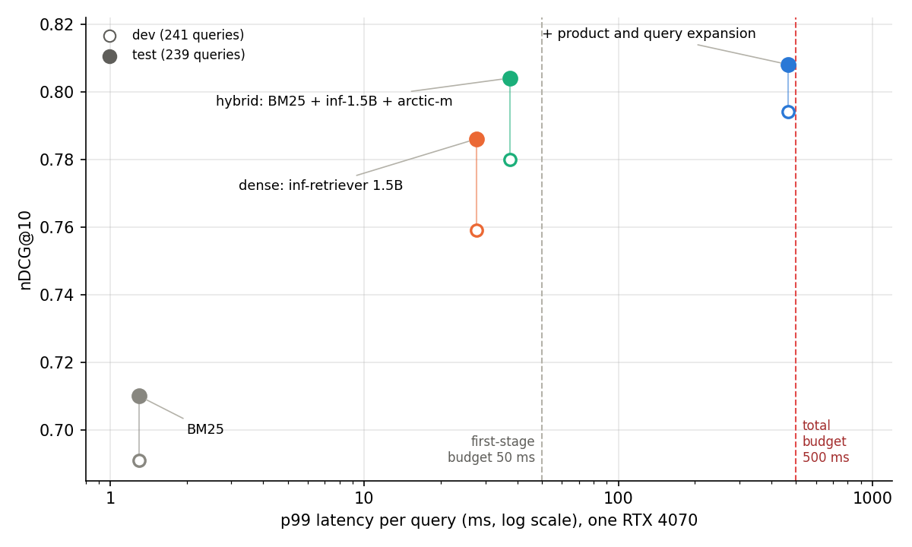
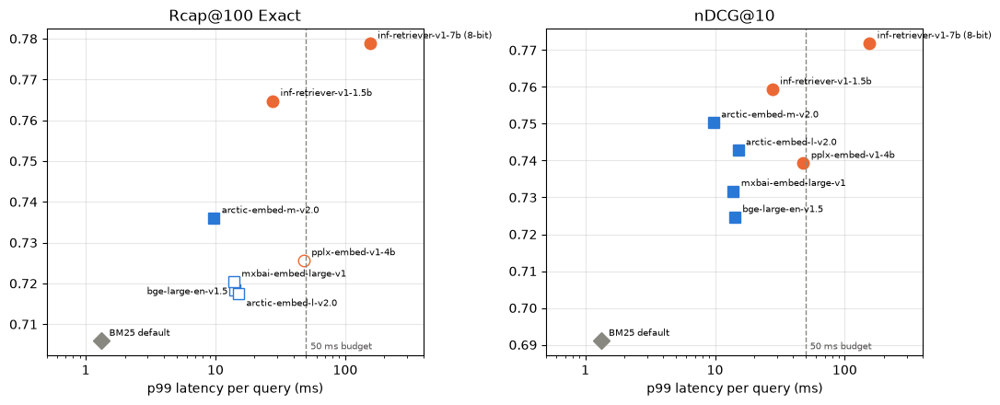
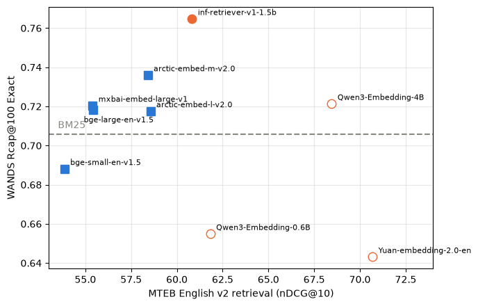
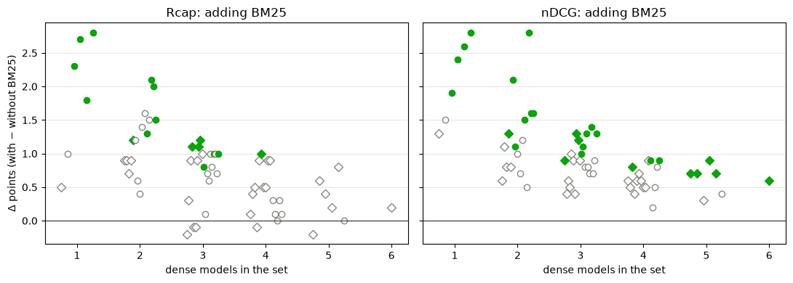
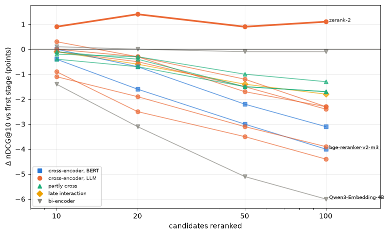
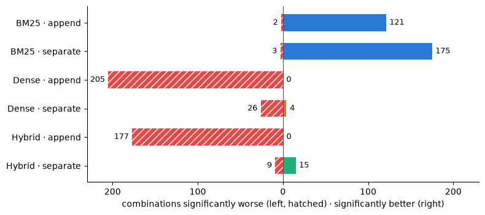
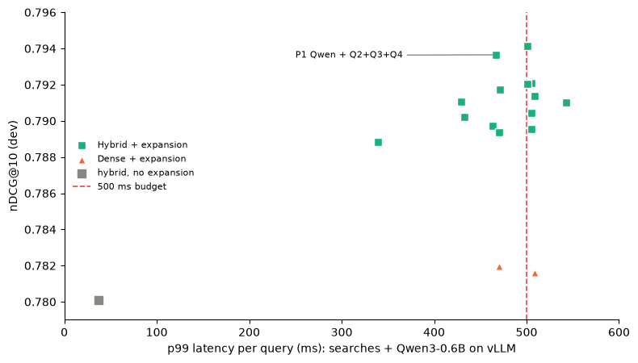
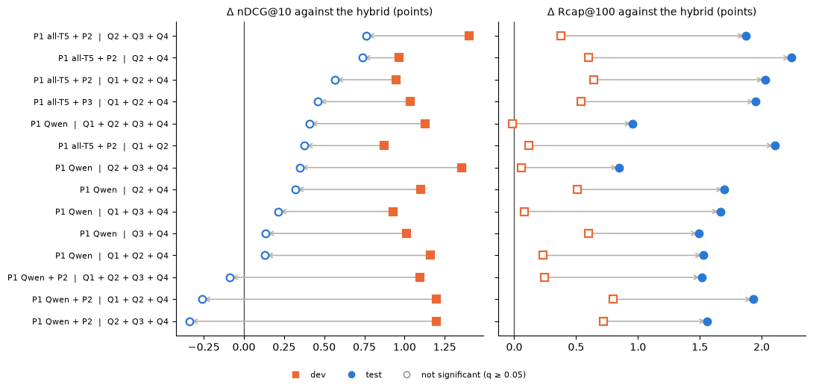

# Product search on a small catalogue

[](LICENSE)
[](https://www.python.org/)
[](https://github.com/astral-sh/uv)
[](https://github.com/astral-sh/ruff)
[](https://mypy-lang.org/)
[](https://github.com/wayfair/WANDS)
[](https://github.com/OlleOltorp/llm-product-search)
[](https://github.com/OlleOltorp/llm-product-search/commits/main)

This started as preparation for a possible master's thesis in search. I wanted to test the leading open-source models from the benchmarks, try hybrid setups, and try add-ons such as rerankers and query and product expansion, to see what actually works on a mid-sized product catalogue and what doesn't. I also wanted it fast enough to use: everything is measured against a latency budget on one consumer GPU.



*Best setting at each stage, chosen on dev (hollow) and checked once on test (filled). Test queries score 2–3 points higher for every system, so compare systems within a split.*

## Results

| Stage | Best setting | nDCG@10 dev | nDCG@10 test | p99 latency |
|---|---|---|---|---|
| Keyword search | BM25, default settings | 0.691 | 0.710 | 1.3 ms |
| Dense retrieval | inf-retriever-v1-1.5b | 0.759 | 0.786 | 28 ms |
| Hybrid | BM25 + inf-1.5B + arctic-embed-m, reciprocal rank fusion | 0.780 | **0.804** | **37 ms** |
| + reranker | zerank-2 on the top 10 | 0.789 | – | ~470 ms (est.) |
| + expansion | product + query expansion, Qwen3-0.6B for queries | 0.794 | 0.808 | 467 ms |

- **Hybrid search is the reliable win:** +1.9 nDCG@10 over the best single model on test (p = 0.002), for 37 ms.
- **Expansion is a big win for BM25** (151 of 161 combinations still significant on test), but on top of the hybrid it did not improve the top 10 on test. It adds +1 to +2 points of recall in the top 100 instead, for ~470 ms.
- Only 1 of 15 rerankers helped, and it costs most of the latency budget.
- The MTEB leaderboard did not predict which embedding model would do best here.
- The inference engine mattered more than model size: vLLM was ~70× faster than transformers for the same model.

All choices were made on 241 dev queries; the 239 test queries were used once, at the end ([notebook 08](notebooks/08_test.ipynb)). The reranker was dropped on dev and not run on test.

## Setup

| | |
|---|---|
| Data | [WANDS](https://github.com/wayfair/WANDS) (Wayfair): 42,994 products, 480 real queries, 233,448 human labels (Exact / Partial / Irrelevant). Nearly every product is judged, so unusual but relevant hits are not punished. |
| Split | 241 dev / 239 test queries, balanced by number of Exact matches, near-duplicates kept together |
| Metrics | nDCG@10 (top-10 quality), Rcap@100 (recall in the top 100). Details in [docs/evaluation.md](docs/evaluation.md) |
| Rule | A change is kept only if significantly better: paired permutation test, p < 0.05. Benjamini-Hochberg q-values when many settings are tested at once |
| Hardware | Ryzen 9 7900X3D, 64 GB RAM, RTX 4070 12 GB. One query at a time, background apps closed |
| Budget | p99 ≤ 50 ms for the first stage, ≤ 500 ms for the whole search |

## Steps

### 1. BM25 · [notebook 03](notebooks/03_bm25.ipynb)

- 420 settings: fields, stemming, k1 and b.
- Stemming (+4.5 Rcap@100) and the description field (+5.6) matter.
- Tuning k1/b does not (best setting +1.6, p = 0.11). Kept the default.

### 2. Dense retrieval · [notebook 04](notebooks/04_dense.ipynb)

- 11 off-the-shelf embedding models, 33M to 7B parameters.
- 7 of 11 beat BM25 on nDCG@10; only 3 of 11 on Rcap@100.
- Models that read text both ways all matched or beat BM25; left-to-right LLM embedders never did.
- inf-retriever-v1-1.5b: best within 50 ms.





### 3. Hybrid (fusion) · [notebook 05](notebooks/05_fusion.ipynb)

- All 120 combinations of BM25 + 6 dense models, merged with RRF.
- None found more relevant products than inf-1.5B alone, but several ranked the top 10 better.
- Pick: BM25 + inf-1.5B + arctic-embed-m, +2.1 nDCG@10 (p = 0.004), 37 ms.
- Adding BM25 raised nDCG@10 in all 63 dense sets. Tuned weights never beat plain RRF.



### 4. Rerankers · [notebook 06](notebooks/06_rerankers.ipynb)

- 15 off-the-shelf rerankers on the hybrid's top 10, 20, 50 and 100.
- Only zerank-2 helped: +0.9 at depth 10 (p = 0.008), at ~470 ms.
- The rest got worse the deeper they reranked.



### 5. Query and product expansion · [notebook 07](notebooks/07_expansion.ipynb)

| | The LLM adds | Model | Based on |
|---|---|---|---|
| P1 | searches a shopper might type | docTTTTTquery T5, Qwen3-8B | docTTTTTquery, Doc2Query-- |
| P2 | words missing from the product text | Qwen3-8B | Doc2Token |
| P3 | attributes: type, colour, material, style, room | Qwen3-8B | WDC-PAVE |
| Q1 | keywords and synonyms | Qwen3-4B / 0.6B | Jagerman et al. 2023 |
| Q2 | attributes the shopper implies | Qwen3-4B / 0.6B | BEQUE |
| Q3 | an imagined matching product | Qwen3-4B / 0.6B | query2doc, HyDE |
| Q4 | keywords after seeing the top 5 results | Qwen3-4B / 0.6B | LameR, CSQE |

- Products expanded once, offline; queries live.
- Two ways to use them: appended to the text, or as separate lists merged with RRF.
- 1,530 tests across BM25, dense and hybrid.
- BM25 improved in 296 of 510 combinations. Appended to dense or hybrid: never better.
- Hybrid on dev: only P1 + Q4 as separate lists helped, up to +1.4. On test that top-10 gain mostly disappeared (see step 6).
- Qwen3-0.6B was as good as 4B for queries; 7 combinations fit 500 ms on vLLM.
- Why it works: not missing words (right products already hold 82% of the query's words), but two extra rankings nearly as good as the original.





### 6. Test set · [notebook 08](notebooks/08_test.ipynb)

- Run once, on everything chosen on dev: BM25, inf-1.5B, arctic-m, the hybrid, and the 177 expansion combinations that were significant on dev.
- Held: dense beats BM25 (+7.6), hybrid beats inf-1.5B (+1.9, p = 0.002), expansion helps BM25 (151 of 161).
- Did not hold: expansion's top-10 gain on the hybrid (+0.1 to +0.8, none significant, against +0.9 to +1.4 on dev). Picking the best of hundreds of combinations on 241 queries overstated it.
- New on test: the same 14 combinations raise recall in the top 100 by +0.8 to +2.2, all significant.



## Limits

- One dataset, built around its 480 queries.
- Rerankers and the 7B dense model were dropped on dev and not run on test.
- Latency for one user; expanded-search pieces timed separately, not on one shared GPU.
- No fine-tuning; all models off the shelf.

## Next

- Fine-tune an embedding model or reranker on synthetic queries for a small catalogue.
- Move the expansion gain offline, into the product index.
- Check the results on a larger catalogue (TREC Product Search 2023, 1.66M products).
- Measure the full system on one shared GPU.

## Repository

```
src/product_search/   data, retrieval (BM25, dense, fusion, rerank), expansion, evaluation
scripts/              one entry point per experiment
configs/              one YAML file per model or run
notebooks/            01–08, one per step
docs/evaluation.md    evaluation rules
results/            metrics for every run (dev.csv, test.csv)
tests/                pytest
```

## Running it

Python 3.12 and [uv](https://docs.astral.sh/uv/). Experiments ran on Windows with CUDA 13.

```bash
uv sync --extra cu130          # or --extra cpu without a GPU
uv run --extra cu130 python scripts/prepare_data.py
uv run --extra cu130 python scripts/make_split.py
uv run --extra cu130 python scripts/run_bm25.py --config configs/bm25_default.yaml
uv run --extra cu130 python scripts/run_dense.py --config configs/dense_inf_15b.yaml
uv run --extra cu130 python scripts/fuse.py rrf
```

Runs are written to `runs/<name>/`; `scripts/evaluate.py` scores a run and adds it to `results/dev.csv`. Query expansion on vLLM: `scripts/serve_vllm.ps1` (Docker) + `scripts/expand.py`.

## Licence

Code: [MIT](LICENSE). WANDS (MIT, Wayfair) is downloaded by `scripts/prepare_data.py`, not stored here.
